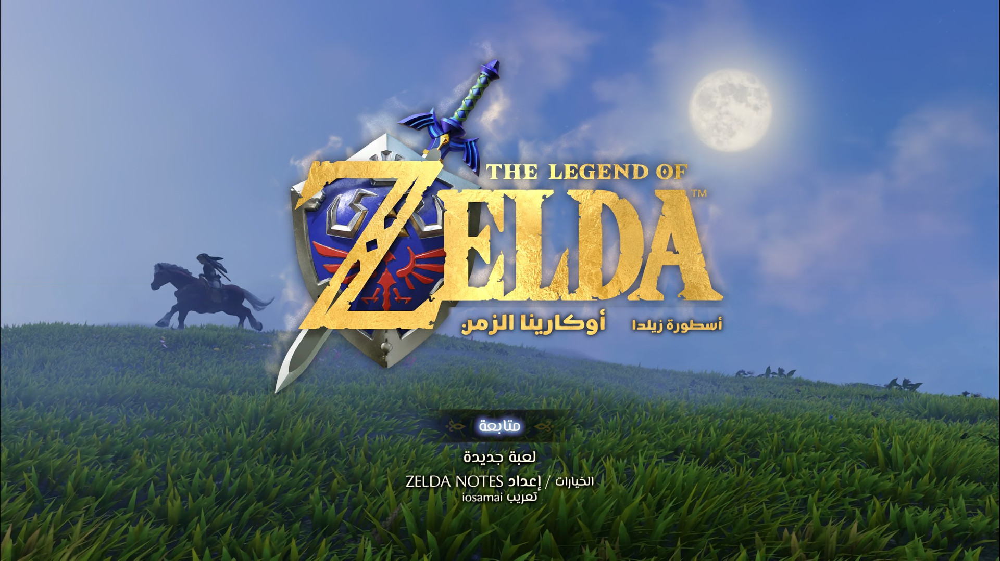
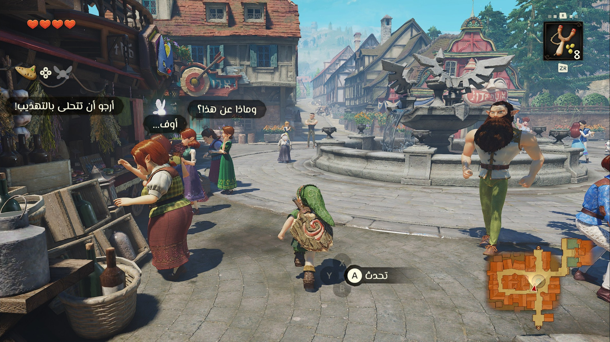
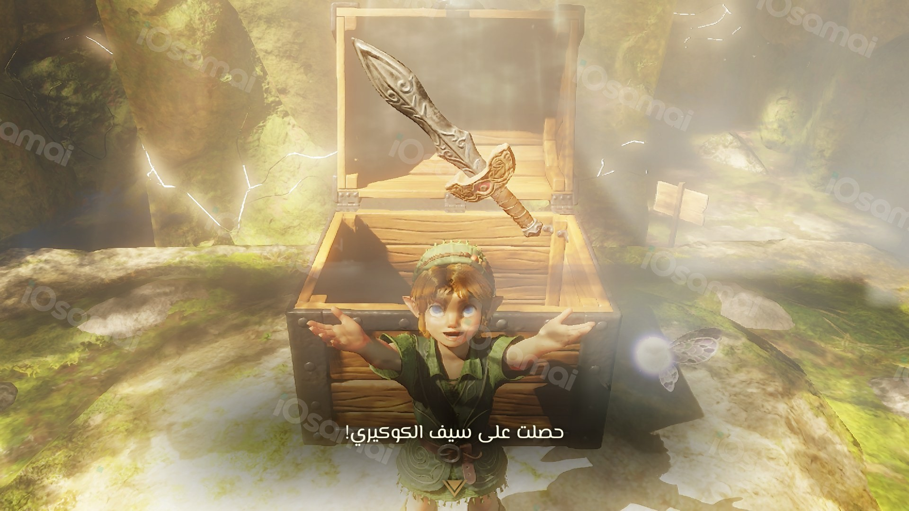
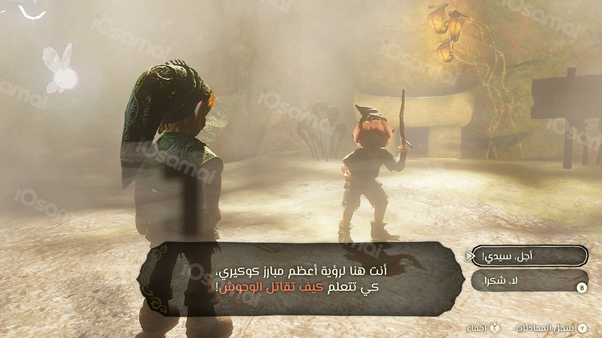
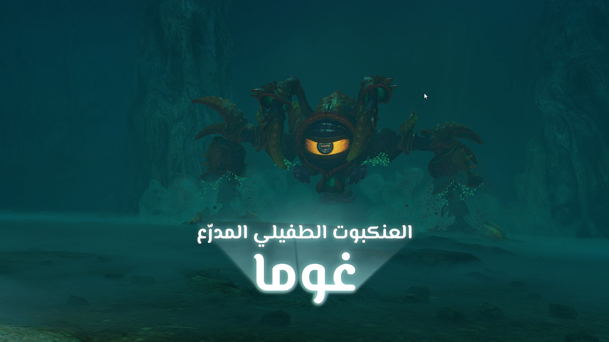
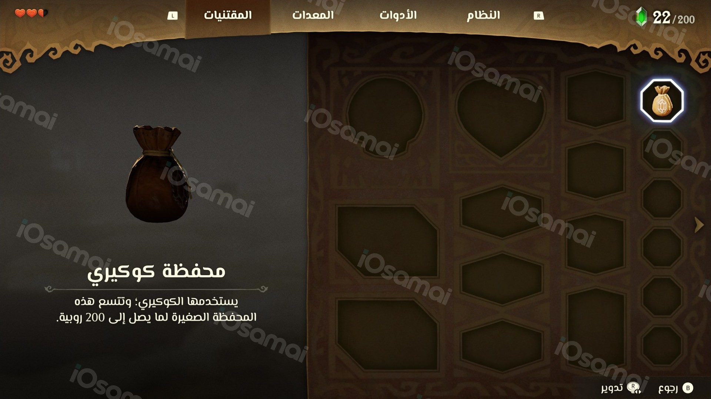
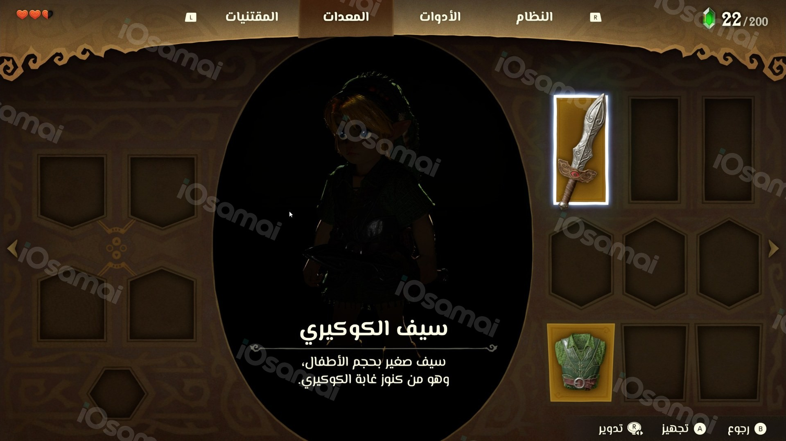

# تعريب ريميك The Legend of Zelda: Ocarina of Time | Ocarina of Time Remake Arabic

تعريب كامل لريميك The Legend of Zelda: Ocarina of Time (زيلدا: أوكارينا الزمن، أوكارينا أوف تايم) على نينتندو سويتش 2 (الإصدار 1.1.1): الحوارات، القوائم والإعدادات، أسماء الأماكن والشخصيات، الأدوات والمعدات، شروح الحركات، والتلميحات والرسائل، وأيضًا شعار اللعبة وأسماء الزعماء. التعريب يحل محل الإنجليزية.

> **تعريب فقط، بدون أي ملفات من اللعبة.** لازم تكون عندك نسختك الخاصة من اللعبة. هذا المستودع ما فيه لعبة ولا مفاتيح ولا روابط تحميل لها.

## اللي تحتاجه

1. ملف اللعبة `nup.` بالإصدار **1.1.1**: إما ملف مدمج 1.1.1، أو ملف فيه اللعبة الأساسية مع تحديث 1.1.1 (v131072). الاثنين مجربين.
2. لغة اللعبة: **English**.
3. محاكي [**Lichii Frizti v3**](https://github.com/Frizti/Lichii/releases/tag/frizti-v3)، حمّل الملف `Lichii-Frizti-v3-Windows-x64.zip` (مو Source code ولا ملف debug-symbols)، فك ضغطه وشغّل `lichii.exe`. الإعدادات اللي تحتاجها اللعبة جاهزة فيه، وأول مرة يسألك: **60 FPS** (يحتاج معالج سريع) أو **30 FPS** للأجهزة الأضعف، وتقدر تغيّرها من الزر جنب DOCKED.
   إذا ظهر العالم أسود: في إعدادات اللعبة الخاصة اختر **Docked** ودقة **1x** وفعّل **Sync memory operations**.

## التثبيت

1. سكّر المحاكي. حمّل `ZeldaOoT-Arabic-1.3.1.zip` من [Releases](../../releases/latest) وفك ضغطه.
2. افتح `ZeldaOoTArabic.exe`. إذا ظهرت رسالة "Windows protected your PC"، اضغط More info ثم Run anyway.
3. الخطوة 1: «اختيار ملف اللعبة» واختر ملف `nup.` حقك.
4. الخطوة 2 (اختيارية): «اختيار الخط». الخط الافتراضي هو المسيري.
5. الخطوة 3: «تثبيت التعريب». إذا كان عليه إصدار أقدم يصير الزر «تحديث التعريب».
6. شغّل اللعبة من المحاكي.

البرنامج يتأكد إن الملف هو الإصدار 1.1.1 الأصلي قبل أي تعديل، وإذا ما كان كذا يرفض وما يغيّر شيء. البرنامج بالعربي، وفيه زر English فوق إذا تبيه بالإنجليزي.

خلّ ملف `arabic-undo.` جنب ملف اللعبة ولا تحذفه، وإذا نقلت ملف اللعبة انقله معه، لأن تغيير الخط والتحديث والإزالة يحتاجونه.

## الخطوط

فيه 11 خطًا تختار منها، وتقدر تشوف كل خط على صورة من اللعبة قبل التثبيت: المسيري (الافتراضي)، فسطاط، ميرزا، كاتبة، روبيك، وزير متن، لاله زار، الإسكندرية، آلان، مرحي، بلاي بين.

تقدر تختار خطًا واحدًا للعبة كلها، أو خطًا مختلفًا لكل جزء: الحوار والنصوص، العناوين الصغيرة، القوائم والعناوين، الأسماء الكبيرة.

لتغيير الخط بعد التثبيت: افتح البرنامج، اختر نفس الملف، اختر الخط، ثم «تطبيق الخط فقط».

### أضف خطك

من شاشة الخطوط اضغط «+ أضف خطك» واختر ملف `ttf.` أو `otf.` فيه حروف عربية. تقدر تضيف حتى 7 خطوط وتوزعها على الأجزاء الأربعة، والبرنامج يتذكرها في المرة الجاية.

- الخطوط اللي في القائمة هي المجربة فقط. خطك قد تطلع بعض حروفه صغيرة أو ناقصة؛ إذا ما عجبك ارجع للخط الافتراضي.
- إذا كان الخط في `C:\Windows\Fonts`، انسخه لمجلد ثاني أول ثم اختره من هناك.
- استخدم خطك على نسختك فقط، ورخصته مسؤوليتك.

## الإزالة

افتح البرنامج، اختر نفس الملف واضغط «إزالة التعريب» تحت، ثم أكّد. يرجع الملف الأصلي كما كان بالضبط.

## مشاكل معروفة

- المحاكي قد يعلق أحيانًا. احفظ لعبتك كثير. هذي مشكلة في المحاكي، مو في التعريب.
- نادرًا تظهر شاشة تحميل شديدة الإضاءة أو بلون غريب: أعد تشغيل اللعبة. مشكلة معروفة في المحاكي.
- إذا نسخت ملف لعبة معرّب بدون ملف `arabic-undo.` اللي جنبه، البرنامج يعتبره غير مثبت ويرفضه. انسخ الملفين مع بعض.

## الحقوق

ترجمة وتعريب: **iOsamai**. ممنوع إعادة رفع الملفات في أي مكان آخر، شارك رابط هذي الصفحة بدلها.

| | |
|---|---|
|  |  |
|  |  |
|  |  |

---

## English

Complete Arabic translation of the Nintendo Switch 2 remake of The Legend of Zelda: Ocarina of Time (version 1.1.1): dialogue,
menus and settings, place and character names, items and equipment, move tutorials, hints and messages, plus the game
logo and the boss title cards. The Arabic replaces English.

> **Arabic patch only, no game files.** You need your own copy of the game. This repository holds no game, no keys and
> no download links for it.

### What you need

1. The game's `.nup` file at version **1.1.1**: either a merged 1.1.1 file, or the base game with the 1.1.1 update
   (v131072). Both are tested.
2. Game language: **English**.
3. The [**Lichii Frizti v3**](https://github.com/Frizti/Lichii/releases/tag/frizti-v3) emulator: download `Lichii-Frizti-v3-Windows-x64.zip` (not Source code or the debug-symbols file), extract it and run `lichii.exe`. The settings the game needs are built in. On the first launch it asks: **60 FPS** (needs a fast CPU) or **30 FPS** for lower-end PCs; switch any time with the button next to DOCKED.
   If the world renders black: in the game's own settings choose **Docked**, resolution **1x**, and turn on **Sync memory operations**.

### Install

1. Close the emulator. Download `ZeldaOoT-Arabic-1.3.1.zip` from [Releases](../../releases/latest) and extract it.
2. Open `ZeldaOoTArabic.exe`. If "Windows protected your PC" appears, click More info, then Run anyway.
3. Step 1: "Choose game file" and pick your `.nup`.
4. Step 2 (optional): "Choose font". The default is El Messiri.
5. Step 3: "Install". If an older version is on the file, the button reads "Update the patch".
6. Start the game in the emulator.

The program checks that the file is the original 1.1.1 before changing anything; if it is not, it refuses and changes
nothing. The program opens in Arabic; the English button at the top switches it to English.

Keep the `.arabic-undo` file next to your game file and do not delete it. If you move the game file, move it too:
font changes, updates and removing the patch need it.

### Fonts

11 fonts to choose from, each shown on a picture from the game before you install: El Messiri (default), Fustat, Mirza,
Katibeh, Rubik, Vazirmatn, Lalezar, Alexandria, Alan Sans, Marhey, Playpen Sans.

Use one font for the whole game, or a different font for each part: dialogue and text, small labels, menus and headings,
big titles.

To change the font after installing: open the program, pick the same file, choose the font, then "Apply font only".

#### Add your own font

On the font screen press "+ Add your font" and pick a `.ttf` or `.otf` file with Arabic letters. You can add up to 7
fonts and give them to any of the four parts; the program remembers them next time.

- Only the fonts in the list are tested. Some letters of your font may come out small or missing; if you do not like it,
  go back to the default font.
- If the font is in `C:\Windows\Fonts`, copy it to another folder first and pick it from there.
- Use your font on your own copy only; its licence is your responsibility.

### Uninstall

Open the program, pick the same file, press "Remove the patch" at the bottom and confirm. The original file comes back
exactly as it was.

### Known issues

- The emulator can freeze now and then. Save often. This is an emulator issue, not the translation.
- Rarely, a loading screen comes up overexposed or tinted: restart the game. A known emulator issue.
- A translated game file copied without the `.arabic-undo` file next to it reads as not installed and is refused. Copy
  both files together.

### Credits

Translation: **iOsamai**. Please do not re-upload these files anywhere else; share a link to this page instead.

Fonts, all under the SIL Open Font License 1.1 (files in `licenses/`): El Messiri, Fustat, Mirza, Katibeh, Rubik,
Vazirmatn, Lalezar, Alexandria, Alan Sans, Marhey, Playpen Sans Arabic; Kufam for the logo line (an image; the font
file itself is not included).

The installer uses HarfBuzz (Old MIT), HarfBuzzSharp (MIT), ZstdSharp (MIT) and zstd (BSD); their notices are in
`licenses/`.

All my translations: https://iosamai.com
