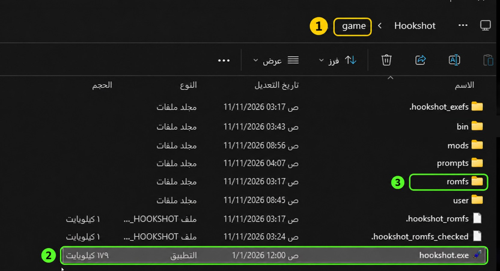

# تعريب ريميك The Legend of Zelda: Ocarina of Time | Ocarina of Time Remake Arabic

تعريب كامل لريميك The Legend of Zelda: Ocarina of Time (زيلدا: أوكارينا الزمن، أوكارينا أوف تايم) على نينتندو سويتش 2 (الإصدار 1.1.1): الحوارات، القوائم والإعدادات، أسماء الأماكن والشخصيات، الأدوات والمعدات، شروح الحركات، والتلميحات والرسائل، وأيضًا شعار اللعبة وأسماء الزعماء. التعريب يحل محل الإنجليزية.

> **تعريب فقط، بدون أي ملفات من اللعبة.** لازم تكون عندك نسختك الخاصة من اللعبة. هذا المستودع ما فيه لعبة ولا مفاتيح ولا روابط تحميل لها.

## اللي تحتاجه

1. ملف اللعبة `nup.` بالإصدار **1.1.1**: إما ملف مدمج 1.1.1، أو ملف فيه اللعبة الأساسية مع تحديث 1.1.1 (v131072). الاثنين مجربين.
2. لغة اللعبة: **English**.
3. محاكي [**Fritchii v5.1**](https://github.com/Frizti/Fritchii/releases/tag/fritchii-v5.1)، حمّل الملف `Fritchii-v5.1-Windows-x64.zip` (مو Source code ولا ملف debug-symbols)، فك ضغطه وشغّل `lichii.exe`.
   - أول تشغيل للعبة يجهّز المؤثرات مرة وحدة (حوالي 15 دقيقة)، بعدها اللعب سلس من البداية.

## التثبيت

**للكمبيوتر:** سكّر المحاكي (أو Hookshot). حمّل [`ZeldaOoT-Arabic-2.0.2.zip`](https://github.com/OSAMAxALHARBI/ZeldaOcarinaOfTimeRemake-Arabic/releases/latest/download/ZeldaOoT-Arabic-2.0.2.zip) من [Releases](../../releases/latest) وفك ضغطه، وافتح `ZeldaOoTArabic.exe`. إذا ظهرت رسالة "Windows protected your PC"، اضغط More info ثم Run anyway.

الخطوة 1 في البرنامج تسألك **أين تلعب؟** اختر وحدة من ثلاث:

### 1) ملف اللعبة (الطريقة المعتادة، كل المحاكيات)

1. اختر «ملف اللعبة» ثم «اختيار ملف اللعبة» وحدد ملف `nup.` حقك.
2. الخطوة 2 (اختيارية): «اختيار الخط». الخط الافتراضي هو المسيري.
3. الخطوة 3 (اختيارية): محاذاة النصوص. الافتراضي «بدون (كالسابق)»: كل سطر في وسط المربع. تقدر تختار «الحوار فقط» أو «الحوار والقوائم» أو «كل النصوص»، وكل خيار معه صور من اللعبة توضح الفرق.
4. الخطوة 4: «تثبيت التعريب». إذا كان عليه إصدار أقدم يصير الزر «تحديث التعريب».
5. شغّل اللعبة من المحاكي.

البرنامج يتأكد إن الملف هو الإصدار 1.1.1 قبل أي تعديل، ويرفضه بدون تغيير إذا ما كان كذا. بعدها يعدّل ملف `nup.` ويحفظ بيانات الإزالة في مكانين: ملف `arabic-undo.` جنب ملف اللعبة، ونسخة ثانية داخل ملف اللعبة نفسه.

**التحديث من 1.0 إلى 1.3.1:** افتح البرنامج الجديد، اختر نفس الملف واضغط «تحديث التعريب». ما تحتاج تزيل الإصدار القديم أول، وحتى لو ضاع ملف `arabic-undo.` القديم، البرنامج يحاول يرجّع الملف الأصلي من ملف اللعبة نفسه ويتأكد منه، وإذا ما قدر ما يغيّر شيء.

### 2) Hookshot PC Port (عندك Hookshot مبني)

1. اختر «Hookshot PC Port» ثم «اختيار مجلد Hookshot».
2. **أي مجلد تختار؟** مجلد اللعبة اللي صنعه Hookshot Builder: فيه `hookshot.exe` ومجلد `romfs` (مو مجلد `bin` اللي بداخله، ومو مجلد Hookshot Builder نفسه). لو اخترت المجلد اللي فوقه أو `bin`، البرنامج يلقى المجلد الصح بنفسه.

   

   **1** اسم المجلد اللي تختاره · **2** فيه `hookshot.exe` · **3** وفيه مجلد `romfs`
3. اختر الخط، ثم «تثبيت التعريب»، وشغّل `hookshot.exe`.
4. التعريب ينزل في مجلد المودات حق Hookshot: `mods\Arabic (iOsamai)`، وملفات اللعبة تبقى كما هي. مع التعريب تظهر أيقونات أزرار Switch الأصلية.
5. إذا نسختك من Hookshot أقدم من v2.0.14، البرنامج يقول لك وتقدر تحمّل الأحدث أو تتجاهل.
6. بعد أي تحديث لـ Hookshot يعيد بناء اللعبة، ثبّت التعريب مرة ثانية.

**نقل الحفظ:** في الخطوة 3 زر «نقل الحفظ» ينقل حفظك من Fritchii أو Lichii أو Eden إلى Hookshot (أو تختار مجلد المحاكي بنفسك). حفظ Hookshot القديم ينحفظ في `user\save-backups`. سكّر Hookshot والمحاكي قبلها.

### 3) بناء Hookshot لي (ما عندك Hookshot)

1. اختر «بناء Hookshot لي» ثم «اختيار ملف اللعبة» وحدد ملف `nup.` حقك (الإصدار 1.1.1، بدون تعريب داخله).
2. اضغط «بناء Hookshot والتثبيت» واختر المكان. يحتاج 45 جيجا فارغة أو أكثر (أكثر على أقراص exFAT) ونحو 40 دقيقة.
3. البرنامج ينزّل آخر إصدار رسمي من Hookshot من GitHub (مجرب على v2.1.0) ويتأكد من كل ملف، ويبني اللعبة على جهازك، ثم يضيف التعريب وينقل أحدث حفظ عندك.
4. تلقى اللعبة في مجلد `Zelda OoT (Hookshot)` داخل المكان اللي اخترته: شغّل `hookshot.exe` منه. أول تشغيل أبطأ قليلا.

البناء يصير على جهازك، فبرنامج الحماية يفحص الملفات. إذا حذف ملف من أدوات البناء (مثل `clang.exe`)، البرنامج يوقف ويقول لك: رجّعه من الحجر وحاول مرة ثانية.

في Hookshot تبقى الأسطر في الوسط؛ خيارات المحاذاة للمحاكيات فقط.

### ملفات المود (Mac وأي Port أو محاكي)

حمّل [`ZeldaOoT-Arabic-2.0.2-Mod-Files.zip`](https://github.com/OSAMAxALHARBI/ZeldaOcarinaOfTimeRemake-Arabic/releases/latest/download/ZeldaOoT-Arabic-2.0.2-Mod-Files.zip) من [Releases](../../releases/latest) وفك ضغطه. فيه مجلد `Arabic (iOsamai)` (فيه `romfs` و`exefs`) بالخط المسيري وكل سطر في الوسط. انسخه لمجلد المودات في اللي تلعب فيه:
- **Port على الكمبيوتر مثل NX2navi:** مجلد `mods` جنب ملف اللعبة `exe`.
- **محاكي على Mac** (Eglantine أو Lichii، لأجهزة Mac بمعالج Apple M1 وأحدث) **أو أي محاكي ثاني:** مجلد مودات اللعبة (رقمها `0400486024DEC000`)، بالطريقة اللي يشرحها المحاكي.

لعبتك لازم تكون الإصدار 1.1.1 وبالإنجليزي. هذي الطريقة **ما اختبرها صاحب التعريب** على كل الأجهزة والـ Ports. إذا جربتها، قل لي من صفحة التواصل في iosamai.com.

البرنامج بالعربي، وفيه زر English فوق إذا تبيه بالإنجليزي.

## الترجمة في 2.0

راجعت كل أسطر اللعبة (16,228 سطرًا) مرة ثانية من أولها لآخرها، وصححت مئات الأسطر في المعنى والمصطلحات. الأسعار صارت «X روبية» لأي رقم. أسماء مثل «دين» و«شيك» و«شارب» صارت بلون مميز عشان تنقرأ أسماء، والحروف قبل الكلمات الملوّنة صارت متصلة. وأُعيدت صياغة الكلمات اللي تحتاج شدة، ووُصلت الضحكات مثل «هيهي».

## الخطوط

فيه 11 خطًا تختار منها، وتقدر تشوف كل خط على صورة من اللعبة قبل التثبيت: المسيري (الافتراضي)، فسطاط، ميرزا، كاتبة، روبيك، وزير متن، لاله زار، الإسكندرية، آلان، مرحي، بلاي بين.

تقدر تختار خطًا واحدًا للعبة كلها، أو خطًا مختلفًا لكل جزء: الحوار والنصوص، العناوين الصغيرة، القوائم والعناوين، الأسماء الكبيرة.

لتغيير الخط بعد التثبيت: افتح البرنامج، اختر نفس الملف، اختر الخط، ثم «تطبيق الخط فقط».

### أضف خطك

من شاشة الخطوط اضغط «+ أضف خطك» واختر ملف `ttf.` أو `otf.` فيه حروف عربية. تقدر تضيف حتى 7 خطوط وتوزعها على الأجزاء الأربعة، والبرنامج يتذكرها في المرة الجاية.

- الخطوط اللي في القائمة هي المجربة فقط. خطك قد تطلع بعض حروفه صغيرة أو ناقصة؛ إذا ما عجبك ارجع للخط الافتراضي.
- إذا كان الخط في `C:\Windows\Fonts`، انسخه لمجلد ثاني أول ثم اختره من هناك.
- استخدم خطك على نسختك فقط، ورخصته مسؤوليتك.

## الإزالة

افتح البرنامج، اختر نفس الطريقة ونفس الملف (أو مجلد Hookshot)، واضغط «إزالة التعريب» تحت ثم أكّد:
- ملف اللعبة: يرجع الملف الأصلي كما كان بالضبط.
- Hookshot: ينحذف مجلد `mods\Arabic (iOsamai)` (وترجع الملفات الإنجليزية لو كانت من 2.0).
- ملفات المود: احذف مجلد `Arabic (iOsamai)` من مجلد المودات.

## مشاكل معروفة

- المحاكي قد يعلق أحيانًا. احفظ لعبتك كثير. هذي مشكلة في المحاكي، مو في التعريب.
- نادرًا تظهر شاشة تحميل شديدة الإضاءة أو بلون غريب: أعد تشغيل اللعبة. مشكلة معروفة في المحاكي.

## الحقوق

ترجمة وتعريب: **iOsamai**. ممنوع إعادة رفع الملفات في أي مكان آخر، شارك رابط هذي الصفحة بدلها.

| | |
|---|---|
|  |  |
|  |  |
|  |  |

---

## English

Complete Arabic translation of the Nintendo Switch 2 remake of The Legend of Zelda: Ocarina of Time (version 1.1.1): dialogue,
menus and settings, place and character names, items and equipment, move tutorials, hints and messages, plus the game
logo and the boss title cards. The Arabic replaces English.

> **Arabic patch only, no game files.** You need your own copy of the game. This repository holds no game, no keys and
> no download links for it.

### What you need

1. The game's `.nup` file at version **1.1.1**: either a merged 1.1.1 file, or the base game with the 1.1.1 update
   (v131072). Both are tested.
2. Game language: **English**.
3. The [**Fritchii v5.1**](https://github.com/Frizti/Fritchii/releases/tag/fritchii-v5.1) emulator: download `Fritchii-v5.1-Windows-x64.zip` (not Source code or the debug-symbols file), extract it and run `lichii.exe`.
   - The first start of the game prepares its shaders once (about 15 minutes); after that it plays smoothly.

### Install

**On PC:** close the emulator (or Hookshot). Download [`ZeldaOoT-Arabic-2.0.2.zip`](https://github.com/OSAMAxALHARBI/ZeldaOcarinaOfTimeRemake-Arabic/releases/latest/download/ZeldaOoT-Arabic-2.0.2.zip) from [Releases](../../releases/latest), extract it and open `ZeldaOoTArabic.exe`. If "Windows protected your PC" appears, click More info, then Run anyway.

Step 1 in the program asks **Where do you play?** Pick one of three:

#### 1) Game file (the usual way, every emulator)

1. Pick "Game file", then "Choose game file" and select your `.nup`.
2. Step 2 (optional): "Choose font". The default is El Messiri.
3. Step 3 (optional): text alignment. The default "Off (as before)" centres every line. You can choose "Dialogue only", "Dialogue + menus" or "All text"; each option shows pictures from the game.
4. Step 4: "Install". If an older version is on the file, the button reads "Update the patch".
5. Start the game in the emulator.

The installer checks that the file is version 1.1.1 before changing anything, and refuses it without changes otherwise. It then patches your `.nup` and keeps the removal data in two places: an `.arabic-undo` file next to the game file, and a second copy inside the game file itself.

**Updating from 1.0 to 1.3.1:** open the new installer, pick the same file and press "Update the patch". There is no need to remove the old version first. Even if the old `.arabic-undo` file is lost, the installer tries to rebuild the original from the game file itself and checks it; if it cannot, nothing is changed.

#### 2) Hookshot PC Port (you already built Hookshot)

1. Pick "Hookshot PC Port", then "Choose Hookshot folder".
2. **Which folder?** The game folder the Hookshot Builder made: it has `hookshot.exe` and a `romfs` folder (not the `bin` folder inside it, and not the Hookshot Builder's own folder). If you pick the folder above it or `bin`, the installer finds the right one.

   

   **1** the folder you choose · **2** it has `hookshot.exe` · **3** and a `romfs` folder
3. Pick a font, press "Install", then start `hookshot.exe`.
4. The patch goes into Hookshot's mods folder, `mods\Arabic (iOsamai)`, and the game files stay as they are. With the patch, the game shows its own Switch button icons.
5. If your Hookshot is older than v2.0.14, the installer tells you; download the newer one or ignore it.
6. After a Hookshot update that rebuilds the game, install the patch again.

**Move your save:** step 3 has a "Move my save" button that copies your save from Fritchii, Lichii or Eden to Hookshot (or you choose the emulator folder). Hookshot's old save is kept in `user\save-backups`. Close Hookshot and the emulator first.

#### 3) Build Hookshot (no Hookshot yet)

1. Pick "Build Hookshot", then "Choose game file" and select your `.nup` (version 1.1.1, with no patch inside).
2. Press "Build and install" and choose where it goes. It needs 45 GB free or more (more on exFAT drives) and about 40 minutes.
3. The installer downloads the latest official Hookshot from GitHub (tested on v2.1.0), checks every file, builds the game on your PC, then adds the patch and copies your newest save.
4. The game is in a `Zelda OoT (Hookshot)` folder inside the place you chose: start `hookshot.exe` from it. The first start is a bit slower.

The build runs on your PC, so your antivirus checks the files. If it removes a build tool (such as `clang.exe`), the installer stops and tells you: restore it from quarantine and try again.

In Hookshot lines stay centred; the alignment options are for emulators only.

#### Mod files (Mac and any port or emulator)

Download [`ZeldaOoT-Arabic-2.0.2-Mod-Files.zip`](https://github.com/OSAMAxALHARBI/ZeldaOcarinaOfTimeRemake-Arabic/releases/latest/download/ZeldaOoT-Arabic-2.0.2-Mod-Files.zip) from [Releases](../../releases/latest) and extract it. It holds an `Arabic (iOsamai)` folder (`romfs` and `exefs`) with the El Messiri font and every line centred. Copy it into the mods folder of what you play with:
- **A PC port such as NX2navi:** the `mods` folder next to the game's exe.
- **An emulator on Mac** (Eglantine or Lichii, Apple Silicon M1 or newer) **or any other emulator:** the game's mod folder (title `0400486024DEC000`), the way that emulator adds mods.

Your game must be version 1.1.1, in English. This route is **not tested by the author** on every device and port. If you try it, tell me on the contact page at iosamai.com.

The program opens in Arabic; the English button at the top switches it to English.

### The translation in 2.0

All 16,228 lines of the game were reviewed again from start to end, and hundreds of lines were corrected for meaning and terms. Prices now read «X روبية» for any number. Names such as Din, Sheik and Sharp are coloured so they read as names, and letters before coloured words now join. Words that needed a shadda were reworded, and laughs such as «هيهي» are joined.

### Fonts

11 fonts to choose from, each shown on a picture from the game before you install: El Messiri (default), Fustat, Mirza,
Katibeh, Rubik, Vazirmatn, Lalezar, Alexandria, Alan Sans, Marhey, Playpen Sans.

Use one font for the whole game, or a different font for each part: dialogue and text, small labels, menus and headings,
big titles.

To change the font after installing: open the program, pick the same file, choose the font, then "Apply font only".

#### Add your own font

On the font screen press "+ Add your font" and pick a `.ttf` or `.otf` file with Arabic letters. You can add up to 7
fonts and give them to any of the four parts; the program remembers them next time.

- Only the fonts in the list are tested. Some letters of your font may come out small or missing; if you do not like it,
  go back to the default font.
- If the font is in `C:\Windows\Fonts`, copy it to another folder first and pick it from there.
- Use your font on your own copy only; its licence is your responsibility.

### Uninstall

Open the program, pick the same route and the same file (or Hookshot folder), press "Remove the patch" at the bottom and confirm:
- Game file: the original file comes back exactly as it was.
- Hookshot: the `mods\Arabic (iOsamai)` folder is deleted (and the English files come back if they came from 2.0).
- Mod files: delete the `Arabic (iOsamai)` folder from the mods folder.

### Known issues

- The emulator can freeze now and then. Save often. This is an emulator issue, not the translation.
- Rarely, a loading screen comes up overexposed or tinted: restart the game. A known emulator issue.

### Credits

Translation: **iOsamai**. Please do not re-upload these files anywhere else; share a link to this page instead.

Fonts, all under the SIL Open Font License 1.1 (files in `licenses/`): El Messiri, Fustat, Mirza, Katibeh, Rubik,
Vazirmatn, Lalezar, Alexandria, Alan Sans, Marhey, Playpen Sans Arabic; Kufam for the logo line (an image; the font
file itself is not included).

The installer uses HarfBuzz (Old MIT), HarfBuzzSharp (MIT), ZstdSharp (MIT) and zstd (BSD); their notices are in
`licenses/`.

All my translations: https://iosamai.com
